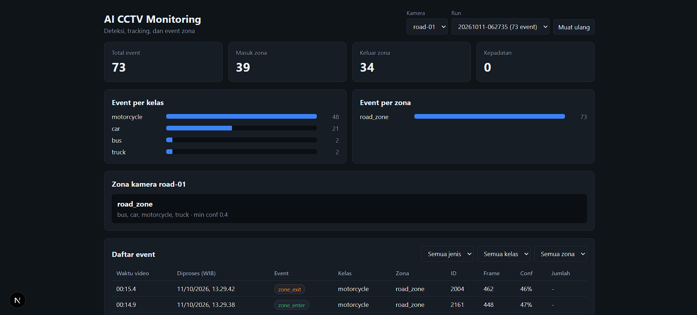

# AI CCTV Monitoring

Computer-vision pipeline and monitoring dashboard for fixed CCTV cameras. It detects and
tracks vehicles with YOLO11 and ByteTrack, evaluates them against per-camera zones, stores
the resulting events in a database, and shows them in a web dashboard.



## Features

- Object detection with pretrained YOLO11 (Ultralytics), configurable classes and confidence
- Multi-object tracking (ByteTrack) with debounced zone enter/exit events
- Per-camera polygon zones with class filters, per-zone confidence thresholds, and
  congestion events (object count above a threshold)
- Input abstraction: image folder, video file, or RTSP stream with automatic reconnection
  and latest-frame buffering
- Annotated video output with bounding boxes, labels, confidence, track IDs, and zones
- Events stored as JSONL and in SQLite (SQLAlchemy); REST API (FastAPI); Next.js dashboard
- 43 automated tests (pytest) that run without a GPU or a model

## Architecture

```text
Source (image folder | video file | RTSP)
   -> preprocess -> detect (YOLO11) -> track (ByteTrack) -> zone check
   -> events (enter / exit / congestion) -> JSONL + SQLite
                                               |
                                               v
                                   FastAPI  ->  Next.js dashboard
```

## Project structure

```text
pipeline/    sources.py and batch01_preprocess ... batch06_visualize
storage/     SQLAlchemy models, session, repository
api/         FastAPI app and response schemas
dashboard/   Next.js dashboard
configs/     per-camera config and zone files
scripts/     pick_zone.py (draw zones by clicking on a frame)
tests/       pytest suite
runner.py    pipeline entry point
```

## Getting started

Requirements: Python 3.10+, Node.js 18.18+ (dashboard). A GPU is not required.

### 1. Pipeline

```bash
python -m venv .venv
# Windows: .venv\Scripts\Activate.ps1      Linux/macOS: source .venv/bin/activate
pip install -r requirements.txt
```

Put a video in `data/raw/<camera>/`, save one frame from it, and draw the zones:

```bash
python scripts/pick_zone.py data/raw/<camera>/frame0.jpg
```

Click the corners of a zone and press Enter. Paste the printed `points: [...]` into
`configs/<camera>-zones.yaml`, then run:

```bash
python runner.py --config configs/<camera>.yaml
```

Outputs go to `data/outputs/<camera>/`: `annotated.mp4` and `events/events.jsonl`. When
`database` is configured, events are also written to `data/monitoring.db`.

### 2. API

```bash
uvicorn api.main:create_app --factory --reload
```

Interactive docs: http://127.0.0.1:8000/docs

### 3. Dashboard

```bash
cd dashboard
npm install
npm run dev
```

Open http://localhost:3000.

### 4. RTSP (simulated camera)

No IP camera is needed to try the RTSP source. Run a local RTSP server
([MediaMTX](https://github.com/bluenviron/mediamtx)) and publish a video to it with FFmpeg:

```bash
# terminal 1
mediamtx

# terminal 2: publish a video in a loop as if it were a camera
ffmpeg -re -stream_loop -1 -i data/raw/<camera>/clip.mp4 -vf scale=1280:-2 \
  -c:v libx264 -preset veryfast -tune zerolatency -g 30 -an \
  -f rtsp -rtsp_transport tcp rtsp://127.0.0.1:8554/road01

# terminal 3
python runner.py --config configs/<camera>-rtsp.yaml --limit 600
```

Set `source.type: rtsp` and `source.path: rtsp://127.0.0.1:8554/road01` in the config.
Because the video loops, event counts from a long RTSP run are not meaningful: the same
vehicles reappear on every loop with new track IDs.

<!-- Add after running the live test: "Reconnection was verified by stopping and
     restarting the publisher while the pipeline was running." -->

## Configuration

| Key | Meaning |
|---|---|
| `camera.name` | Camera name stored in the database (defaults to the output folder name) |
| `database.url` | SQLAlchemy URL, default SQLite (`sqlite:///data/monitoring.db`) |
| `source.type` | `image_folder`, `video_file`, or `rtsp` |
| `source.frame_stride` | Process every Nth frame (video files) |
| `source.reconnect_delay`, `max_retries` | RTSP reconnection: seconds between attempts, consecutive failures before giving up |
| `model.weights`, `conf`, `imgsz`, `classes` | YOLO weights, detection threshold, input size, classes to keep |
| `preprocess.max_side` | Downscale frames whose longest side exceeds this value |
| `tracking.enabled` | Enable ByteTrack (use for video or ordered frames) |
| `events.min_confidence` | Global confidence threshold for events |
| `events.enter_frames` | Consecutive processed frames inside a zone before `zone_enter` |
| `events.exit_grace` | Processed frames an object may disappear before `zone_exit` |
| `output.save_video`, `save_annotated`, `video_fps` | Write `annotated.mp4` / per-frame JPEGs / video frame rate |

Zones (`configs/*-zones.yaml`) support `classes`, `min_confidence`, `congestion_threshold`,
and `object_events: false` for zones used only for counting. Coordinates are normalized
(0 to 1), so a zone file does not depend on the frame size.

## Events

| Event | Meaning |
|---|---|
| `zone_enter` / `zone_exit` | A tracked object entered / left a zone (debounced) |
| `object_in_zone` | Untracked mode: one event per detection inside a zone |
| `congestion` / `congestion_start` / `congestion_end` | Object count in a zone reached its threshold |

Each event carries the class, confidence, track ID, frame number, processing time (UTC),
and, for video files, the position inside the video (`video_time`).

## API

| Endpoint | Description |
|---|---|
| `GET /health` | Liveness check |
| `GET /cameras` | Cameras |
| `GET /cameras/{name}/zones` | Zones of a camera |
| `GET /runs` | Pipeline runs with event counts |
| `GET /events` | Events, newest first. Filters: `camera`, `zone`, `event_type`, `class_name`, `run_id`, `since`, `until`; pagination: `limit`, `offset` |
| `GET /stats` | Event counts by type, class, and zone (same filters) |

## Results and measurements

Test video: a fixed-camera traffic clip, 1920x1080, 30 fps, 15.5 s. One polygon zone
(`road_zone`) covers the center of the intersection.

| Setup | Throughput |
|---|---|
| Offline video: `yolo11m`, `imgsz 960`, every 2nd frame (233 frames), CPU only | 2.0 FPS |
| RTSP, simulated stream 1280x720 at 30 fps: `yolo11n`, `imgsz 640`, CPU only | 5.1 FPS |

All measurements were taken on an AMD Ryzen 7 5800H (no GPU acceleration). In the RTSP
test the same machine was also re-encoding the video for the stream, so the figure is a
conservative estimate; the pipeline processed about 17% of the frames it received and
dropped the rest to stay current.

Event de-duplication: on a 60-frame sample, raw zone entries were 47 for 22 distinct
track IDs. After debouncing (`enter_frames: 3`, `exit_grace: 5`) this dropped to 20
entries for 18 IDs, which removes most of the flicker caused by detections hovering
around the confidence threshold or the zone border.

On the full offline run the pipeline produced 73 events (39 `zone_enter`, 34 `zone_exit`),
and repeated runs on different days gave identical results.

### Validation status

Tracking accuracy and event counts have **not** been validated against a manual
ground-truth count yet. Track IDs created in a run (`unique_objects`) are an upper bound on
the number of vehicles: occluded vehicles can receive a new ID.

## Known limitations

- Zones are defined per camera and are only valid while the camera view stays the same.
- Small or distant objects are often missed, especially with the nano model. In dense
  motorcycle traffic, track IDs switch more often.
- Frame dropping in RTSP mode (needed to stay real-time) makes tracking somewhat less
  stable than offline processing.
- On CPU, the medium model is far below real time (2 FPS).
- Event timestamps are processing time; `video_time` gives the position inside a video file.
- The RTSP source has only been tested against a simulated stream, not a real IP camera.
- The API has no authentication and is meant for local use.
- The annotated video uses the `mp4v` codec, which most browsers cannot play.

## Roadmap

- Validate tracking and counts against a manual ground truth
- Show a frame with zone and detection overlay in the dashboard
- Fine-tune on labeled data and report mAP before and after
- Test the RTSP source with a real camera
- Person and mask detection for indoor scenarios (see the privacy note)

## Testing

```bash
python -m pytest
```

The suite (43 tests) covers zone logic, events and debouncing, storage, the API, video
timing, and RTSP reconnection (with a mocked capture). It needs no GPU, model, or network.

## Data and attribution

- Dataset images used for early experiments: **TODO** (dataset name, author, license, link)
- Test video: **TODO** (source and license)

## Privacy

The system does not identify individuals. Use public data or your own footage, and avoid
publishing raw recordings that show faces or license plates.

## License

To be decided.